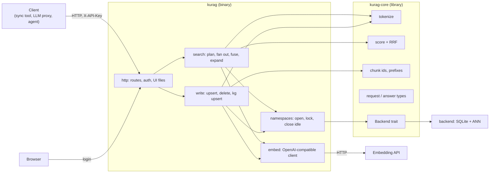
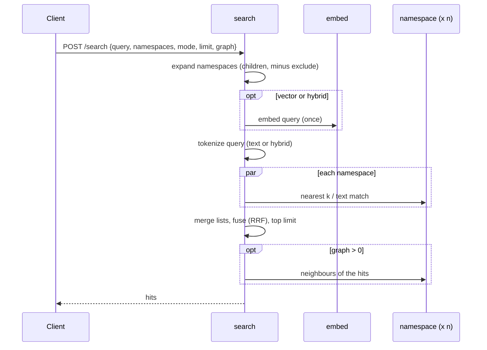

# kurag — architecture (draft)

How kurag is put together. Why it is built this way, and what it does, is in [design.md](design.md). Nothing here
is built yet; parts marked *to measure* wait for numbers.

## Components



| Part | Crate | Does |
|---|---|---|
| `tokenize` | core | Latin words (accents folded, lower case), runs of katakana and kanji cut into bigrams; hiragana dropped from queries |
| `score` | core | Text score (term coverage weighted by length, + BM25 / 10000), RRF, graph expansion scores |
| `ids` | core | `<source>:<path>#<section>#<n>`; prefix ranges; section of a chunk |
| `types` | core | Serde types of every request and answer: the API in code |
| `Backend` | core | The trait each storage engine implements (design.md, "Backend trait") |
| `http` | server | axum routes, API key, UI login, static UI files |
| `search` | server | Picks namespaces, embeds the query once, asks each namespace, merges |
| `write` | server | Embeds outside the namespace lock, then writes in one transaction |
| `namespaces` | server | Opens a namespace on first use, one lock each, closes idle ones to free memory |
| `embed` | server | Batches texts to the embedding API, retries, checks dimensions; picks endpoints (below) |

## Embedding endpoints

```mermaid
flowchart TD
  need["texts to embed"] --> t{"external picker<br/>configured?"}
  t -- no --> fixed["configured URL / list"]
  t -- yes --> size{"large batch?<br/>(> spread_min texts)"}
  size -- no --> rank["ask the picker<br/>(cached a few seconds)"]
  size -- yes --> spread["ask for several machines<br/>(leases)"]
  rank --> ok{"usable endpoints?"}
  spread --> ok
  ok -- yes --> call["call in order / in parallel;<br/>check dimensions"]
  ok -- "no, or picker down" --> fixed
  call --> done["vectors"]
  fixed --> done
  spread -. "end of upsert" .-> release["release leases"]
```

## Requests

Search:



Upsert:

```mermaid
sequenceDiagram
  participant C as Client
  participant W as write
  participant E as embed
  participant N as namespace
  C->>W: POST /upsert {namespace, documents}
  W->>N: which ids are new or changed (text hash)
  W->>E: embed only those (no lock held)
  W->>N: lock; one transaction: chunks, vectors, tokens, similarity edges; reset kg done marks
  N-->>W: count
  W-->>C: {namespace, count}
```

Unchanged chunks are not embedded again. A failed transaction leaves the namespace as it was.

## Storage (SQLite backend)

```
DATA_DIR/
  <namespace>/
    kurag.db       SQLite (WAL): chunks, stored vectors (float16), tokens (FTS5), edges, knowledge graph
    ann/           the ANN index files (format depends on the index chosen)
```

- `kurag.db` is the truth; the ANN index can always be rebuilt from the stored vectors without calling the
  embedding API.
- One namespace per folder, so a namespace can be copied, backed up or removed on its own.
- Memory: the ANN index (quantized) of the namespaces in use, plus SQLite's page cache. Idle namespaces are
  closed.

The tables follow txtai-kura's (chunks, vectors, edges, fts, entities, relations, mentions, kg done marks), so
data can be migrated without re-embedding.

## Concurrency

- One lock per namespace; different namespaces never block each other.
- Embedding calls happen outside locks.
- Searches over several namespaces run in parallel (tokio tasks); the answer waits for the slowest.
- One process per `DATA_DIR`.

## Configuration

One TOML file, with environment variables overriding secrets:

| Key | Meaning |
|---|---|
| `[server] listen`, `data_dir` | Address and data folder |
| `[auth] api_key`, `ui_user`, `ui_password` | Secrets (from the environment in practice) |
| `[embed] url`, `model`, `dimensions`, `batch` | The embedding API (also the fallback) |
| `[embed.picker] url`, `api_key`, `job`, `spread_min`, `cache_seconds` | Optional external picker (a tasukeai-compatible API) |
| `[vector] index`, `quantize` | ANN index and quantization (*to measure*) |
| `[search] hybrid_min_coverage`, `rrf_k`, `graph_min_weight` | Ranking settings, defaults from txtai-kura |
| `[namespaces] idle_close_seconds` | When to close unused namespaces |

## Layout

Same layout as other Rust services by the same author:

```
Cargo.toml            workspace
crates/kurag-core/    library
crates/kurag/         server + CLI
tests/contract/       black-box HTTP tests (run against any server with this API)
docs/                 design.md, architecture.md, api.md, ...
docker/  charts/kurag/  dist/systemd/
```

## Open

- ANN index and its file layout (*to measure*, design.md "Choosing the ANN index").
- Whether similarity edges are computed on upsert (as in txtai-kura) or by a background job when namespaces are
  large.
- Contract test runner: Rust (reqwest) in the workspace, or a language-independent format.
