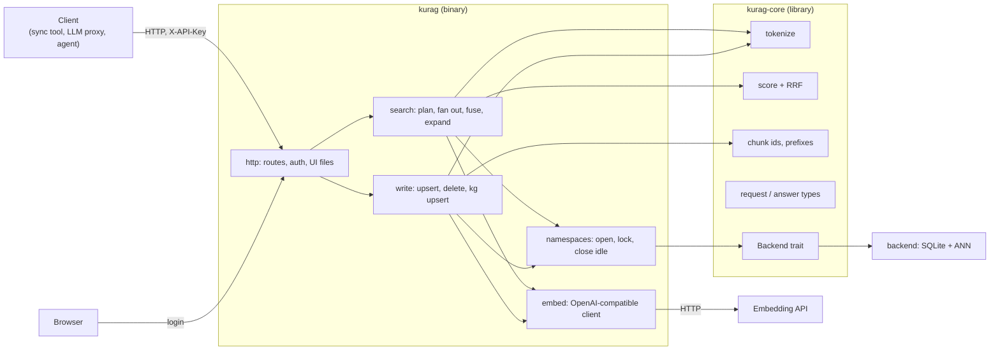
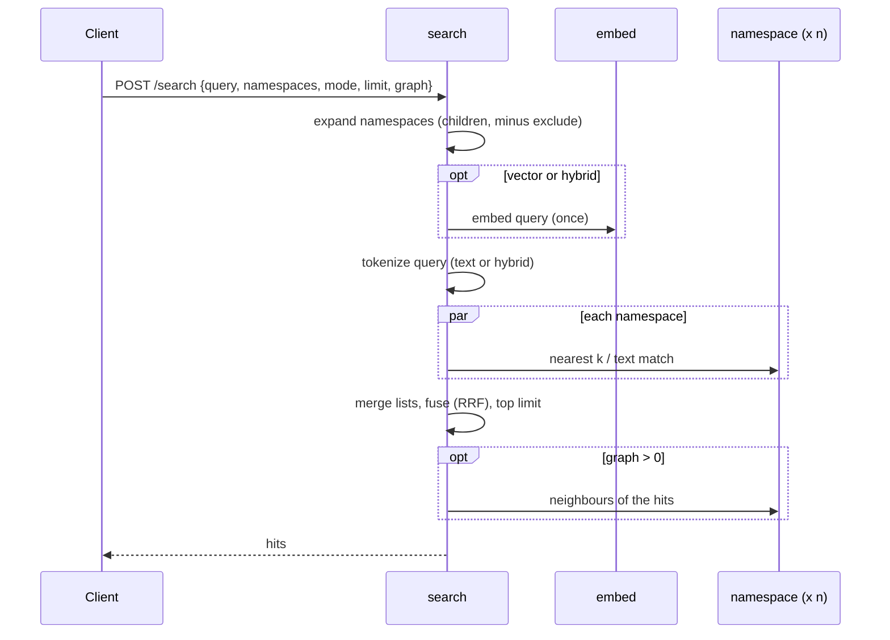

# kurag — architecture (draft)

How kurag is put together. Why it is built this way, and what it does, is in [design.md](design.md); how search
works inside (terms, scores, quantization, graphs) is in [search.md](search.md). Parts marked
*to measure* wait for numbers; what is built so far is listed under "State".

## State (v0.1.0)

Built: `kurag-core` (tokenizer, scores, ids and namespaces, API types) and the `kurag` server with every API v1
route (no UI yet). It passes the contract tests, as txtai-kura does. Differences from the plan below, for now:

- **Settings from the environment only** (`LISTEN`, `DATA_DIR`, `API_KEY`, `EMBED_URL`, `EMBED_MODEL`,
  `EMBED_API_KEY`, `EMBED_BATCH`, `EDGE_NEIGHBOURS`, `EDGE_MIN`); the TOML file comes later.
- **No Backend trait yet.** The SQLite backend is called directly; the trait is cut out of it when a second
  backend is written, so that it follows real code rather than a guess.
- **Vectors: exact search over 8-bit vectors in memory** (`vectors.rs`: a range per dimension learned from the
  vectors, each component stored as one of 256 steps in it, as in faiss's SQ8; loaded from the float16 copies in
  `kurag.db` when a namespace opens, learned again on `/rebuild` and when the number of vectors has doubled). No
  ANN index until measurements call for one.
- **One embedding URL**; no failover list or external picker yet.
- Chunks sent again with the same text reuse their stored vectors (no embedding call); they still get a new row id,
  so the knowledge graph treats them as to do again, as txtai-kura does.
- Namespaces are not closed when idle.

Measured (development build, after the contract tests, 12 small namespaces): 17.9 MB resident.

### Migration from txtai-kura

`kurag import <dir>` copies txtai-kura v0.3 namespaces (`<dir>/<namespace>/kura.db`) into `DATA_DIR`: chunks with
their row ids, float16 vectors, similarity edges and the knowledge graph (with done marks) as they are, full-text
indexes made again with kurag's tokenizer. No embedding calls. Take a copy of a running server's files first
(SQLite backup), and skip namespaces that already exist.

`compare` (in `kurag-contract`) sends the same queries to two servers and prints, per mode, overlap@5, how often
the first hit is the same, and latency.

Measured 2026-11-06 on a copy of a real deployment: 48 namespaces, 263,260 chunks, 768 dimensions, 1.5 GB on
disk; 77 questions from an evaluation set (4 namespaces). txtai-kura v0.3.5 (faiss, 8-bit SQ) and kurag (release
build, rusqlite 0.37, exact search over 8-bit vectors) on the same machine (4 vCPU), same embedding API:

| | txtai-kura | kurag |
|---|---|---|
| Import | | 1 min 8 s, 315 MB peak |
| Resident, every namespace open | 621 MiB | 320-330 MB (vectors 202 MB) |
| vector, one namespace: overlap@5 / top-1 same | | 97.1 % / 94.8 % |
| text, one namespace | | 99.0 % / 98.7 % |
| hybrid, one namespace | | 97.4 % / 96.1 % |
| vector, one namespace, ms p50 / p95 | 51 / 66 | 36 / 47 |
| text, one namespace | 11 / 27 | 6 / 18 |
| hybrid, one namespace | 67 / 88 | 43 / 67 |
| vector over a tree (`it`, `academic`) | 222 / 312 | 105 / 140 |
| text over a tree | 168 / 251 | 113 / 193 |
| hybrid over a tree | 473 / 589 | 236 / 355 |

Latency includes embedding the query (vector, hybrid). On a smaller development VM (2 vCPU, container memory
limit) text search over a tree took about twice as long as txtai-kura on the machine above; the same queries
against both databases on one machine took the same time, so that gap was the environment, not the index.

With the first version, vector results differed in 4-6 of 77 first hits. `kurag recall` (exact search over the float16 copies as the truth,
each question embedded once) shows the difference is kurag's:

| | recall@5, one namespace | top-1 exact | recall@5, over a tree | top-1 exact |
|---|---|---|---|---|
| txtai-kura (faiss SQ8: range trained per dimension) | 99.2 % | 100 % | 99.2 % | 98.7 % |
| kurag, first version (fixed x 127 for every dimension) | 97.1 % | 94.8 % | 96.9 % | 92.2 % |
| kurag, range per dimension | 99.0 % | 100 % | 99.2 % | 100 % |

The components of a 768-dimension unit vector are small (typical size 1 / sqrt(768) = 0.036), so a fixed x 127
left most of the 255 steps unused. With a range per dimension kurag matches txtai-kura (overlap@5 with it 99.2 %
in one namespace, 99.5 % over a tree) at the same speed (vector over a tree 111 ms p50 on the development VM, 113
before) and the same memory.

## Components



| Part | Crate | Does |
|---|---|---|
| `tokenize` | core | Latin words (accents folded, lower case), runs of katakana and kanji cut into bigrams; hiragana dropped from queries |
| `score` | core | Text score (term coverage weighted by length, + BM25 / 10000), RRF, graph expansion scores |
| `ids` | core | `<source>:<path>#<section>#<n>`; prefix ranges; section of a chunk |
| `types` | core | Serde types of every request and answer: the API in code |
| `Backend` | core | The trait each storage engine implements (design.md, "Backend trait") |
| `http` | server | axum routes, API key, UI login, static UI files |
| `search` | server | Picks namespaces, embeds the query once, asks each namespace, merges |
| `write` | server | Embeds outside the namespace lock, then writes in one transaction |
| `namespaces` | server | Opens a namespace on first use, one lock each, closes idle ones to free memory |
| `embed` | server | Batches texts to the embedding API, retries, checks dimensions; picks endpoints (below) |

## Embedding endpoints

```mermaid
flowchart TD
  need["texts to embed"] --> t{"external picker<br/>configured?"}
  t -- no --> fixed["configured URL / list"]
  t -- yes --> size{"large batch?<br/>(> spread_min texts)"}
  size -- no --> rank["ask the picker<br/>(cached a few seconds)"]
  size -- yes --> spread["ask for several machines<br/>(leases)"]
  rank --> ok{"usable endpoints?"}
  spread --> ok
  ok -- yes --> call["call in order / in parallel;<br/>check dimensions"]
  ok -- "no, or picker down" --> fixed
  call --> done["vectors"]
  fixed --> done
  spread -. "end of upsert" .-> release["release leases"]
```

## Requests

Search:



Upsert:

```mermaid
sequenceDiagram
  participant C as Client
  participant W as write
  participant E as embed
  participant N as namespace
  C->>W: POST /upsert {namespace, documents}
  W->>N: which ids are new or changed (text hash)
  W->>E: embed only those (no lock held)
  W->>N: lock; one transaction: chunks, vectors, tokens, similarity edges; reset kg done marks
  N-->>W: count
  W-->>C: {namespace, count}
```

Unchanged chunks are not embedded again. A failed transaction leaves the namespace as it was.

## Storage (SQLite backend)

```
DATA_DIR/
  <namespace>/
    kurag.db       SQLite (WAL): chunks, stored vectors (float16), tokens (FTS5), edges, knowledge graph
    ann/           the ANN index files (format depends on the index chosen)
```

- `kurag.db` is the truth; the ANN index can always be rebuilt from the stored vectors without calling the
  embedding API.
- One namespace per folder, so a namespace can be copied, backed up or removed on its own.
- Memory: the ANN index (quantized) of the namespaces in use, plus SQLite's page cache. Idle namespaces are
  closed.

The tables follow txtai-kura's (chunks, vectors, edges, fts, entities, relations, mentions, kg done marks), so
data can be migrated without re-embedding.

## Concurrency

- One lock per namespace; different namespaces never block each other.
- Embedding calls happen outside locks.
- Searches over several namespaces run in parallel (tokio tasks); the answer waits for the slowest.
- One process per `DATA_DIR`.

## Configuration

One TOML file, with environment variables overriding secrets:

| Key | Meaning |
|---|---|
| `[server] listen`, `data_dir` | Address and data folder |
| `[auth] api_key`, `ui_user`, `ui_password` | Secrets (from the environment in practice) |
| `[embed] url`, `model`, `dimensions`, `batch` | The embedding API (also the fallback) |
| `[embed.picker] url`, `api_key`, `job`, `spread_min`, `cache_seconds` | Optional external picker (a tasukeai-compatible API) |
| `[vector] index`, `quantize` | ANN index and quantization (*to measure*) |
| `[search] hybrid_min_coverage`, `rrf_k`, `graph_min_weight` | Ranking settings, defaults from txtai-kura |
| `[namespaces] idle_close_seconds` | When to close unused namespaces |

## Deployment

One static binary (`kurag`, x86-64 musl, about 8 MB), shipped two ways:

- **Container image**: `docker/Dockerfile` builds it in `rust:1-alpine` and copies it onto
  `gcr.io/distroless/static-debian12:nonroot` (no shell; runs as uid 65532; `DATA_DIR=/data`, a volume; port 9650).
  `docker build -f docker/Dockerfile -t kurag .` from the repository root.
- **Binary and systemd unit**: `--target bin --output type=local,dest=out` writes only the binary to `out/`;
  `dist/systemd/kurag.service` runs it as user `kurag` with data in `/var/lib/kurag` and settings in
  `/etc/kurag/kurag.env`.

The release profile (LTO, one codegen unit, stripped) is set by environment variables in the Dockerfile, not in
`Cargo.toml`, so that local release builds stay fast. Required settings: `API_KEY` and `EMBED_URL` (the server
exits with a message without them). TLS to the embedding API uses the bundled Mozilla roots (webpki-roots), not the
system store, so an embedding API behind a private CA needs plain HTTP on a trusted network for now. On SIGTERM the
server finishes the requests in flight and exits. The release binary passes the contract tests.

## Layout

Same layout as other Rust services by the same author:

```
Cargo.toml            workspace
crates/kurag-core/    library
crates/kurag/         server + CLI
crates/kurag-sync/    client: sources -> chunks -> server; knowledge graph extraction
ui/                   kurag-ui: the browser app (own build); its output is embedded in the server
                      (feature "ui", served at /ui) or hosted on its own against the API
tests/contract/       black-box HTTP tests (run against any server with this API) and fake-embed, the
                      stand-in embedding API they need (design.md, "Contract tests")
docs/                 design.md, architecture.md, api.md, ...
docker/               Dockerfile: the image, or only the binary (--target bin)
dist/systemd/         kurag.service, an example unit for the binary
charts/kurag/         (later) Helm chart
```

## Open

- ANN index and its file layout (*to measure*, design.md "Choosing the ANN index").
- Whether similarity edges are computed on upsert (as in txtai-kura) or by a background job when namespaces are
  large.
