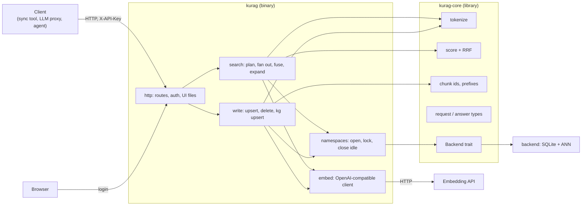
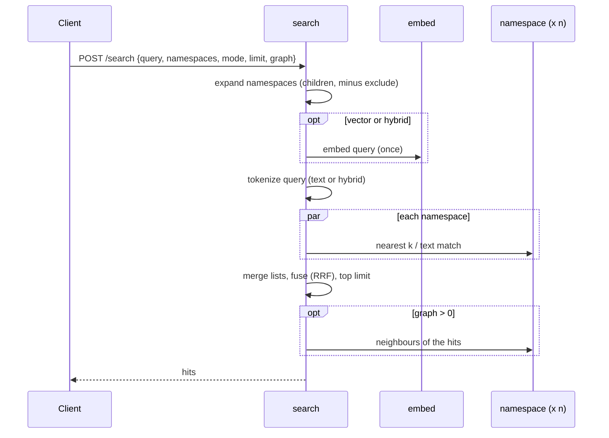
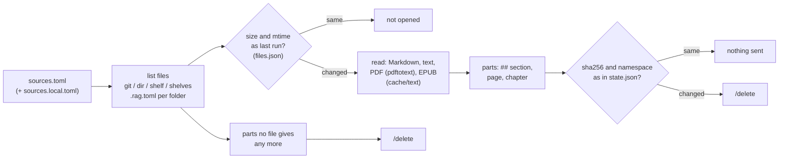

# kurag — architecture (draft)

How kurag is put together. Why it is built this way, and what it does, is in [design.md](design.md); how search
works inside (terms, scores, quantization, graphs) is in [search.md](search.md); the API, settings, deployment,
resources and development each have their own page ([api.md](api.md), [configuration.md](configuration.md),
[deployment.md](deployment.md), [operations.md](operations.md), [development.md](development.md)). Parts marked
*to measure* wait for numbers; what is built so far is listed under "State".

## State (v0.4.1)

Built: `kurag-core` (tokenizer, scores, ids and namespaces, API types) and the `kurag` server with every API v1
route, and the graph view (`/ui`, the txtai-kura view ported, nodes labelled with keywords: search.md, "Graph view
and section labels"). It passes the contract tests, as txtai-kura does. Differences from the plan below, for now:

- **Settings from the environment only** (`LISTEN`, `DATA_DIR`, `API_KEY`, `EMBED_URL`, `EMBED_MODEL`,
  `EMBED_API_KEY`, `EMBED_BATCH`, `EDGE_NEIGHBOURS`, `EDGE_MIN`, `VECTOR_BACKEND`, `VECTOR_URL`, `GRAPH_BACKEND`,
  `GRAPH_URL`, `UI_USER`, `UI_PASSWORD`); the TOML file comes later. Without `UI_PASSWORD` there is no `/ui`.
- **The UI is plain files** (`ui/`: HTML, JavaScript, CSS and Cytoscape.js 3.30.2 in `ui/vendor/`), built into the
  binary with the cargo feature `ui` (on by default), behind a Basic login. No build step and no request to a CDN.
  It is read-only: search, hubs, sections around one, the text of a section; the knowledge-graph view comes later.
- **The backend trait covers the vector index** (`backend.rs`, `RemoteIndex`): `VECTOR_BACKEND=memory` (default)
  is exact search over 8-bit vectors in memory (`vectors.rs`: a range per dimension learned from the vectors, as in
  faiss's SQ8; loaded from the float16 copies in `kurag.db` when a namespace opens, learned again on `/rebuild`
  and when the number of vectors has doubled); `txtai` puts the search in txtai's ANN (faiss) through
  `backends/txtai/`; `helixdb` in a HelixDB server (HNSW, on disk). Chunks, full text, edges and the knowledge
  graph stay in SQLite for every backend; the external index is filled from the float16 copies (search.md, "Vector
  index backends", with measurements). The other parts of the planned trait (full text, graph) are cut out when an
  engine is used for them.
- **A second backend trait for graphs** (`GraphStore` in `backend.rs`): `GRAPH_BACKEND=sqlite` (default) walks the
  namespace's tables, `helixdb` a copy in a HelixDB server kept at the tables' `graph_version` (search.md, "Graph
  backends"). `/search` takes `kg: n` (hybrid only) to fuse the chunks the knowledge graph reaches from the query.
- **One embedding URL**; no failover list or external picker yet.
- **`kurag-sync` has extraction and sync** (crate `crates/kurag-sync`, built with the server by
  `docker/Dockerfile`, both binaries). `extract` is the port of txtai-kura-sync 0.4.1's `extract`, with the same
  command line, config keys, prompt, answer schema and limits (a test pins them to a dump of the Python ones, key
  order included: the model writes its answer in the schema's order, and sorted keys gave other answers). On the
  same two chunks and model, both give the same entities, relations and mentions. `run`, `status` and `shelves`
  are the port of the sync (below, "Sync client").
- Chunks sent again with the same text reuse their stored vectors (no embedding call); they still get a new row id,
  so the knowledge graph treats them as to do again, as txtai-kura does.
- Namespaces are not closed when idle.

Measured (development build, after the contract tests, 12 small namespaces): 17.9 MB resident.

### Migration from txtai-kura

`kurag import <dir>` copies txtai-kura v0.3 namespaces (`<dir>/<namespace>/kura.db`) into `DATA_DIR`: chunks with
their row ids, float16 vectors, similarity edges and the knowledge graph (with done marks) as they are, full-text
indexes made again with kurag's tokenizer. No embedding calls. Take a copy of a running server's files first
(SQLite backup), and skip namespaces that already exist.

`compare` (in `kurag-contract`) sends the same queries to two servers and prints, per mode, overlap@5, how often
the first hit is the same, and latency.

Measured 2026-11-06 on a copy of a real deployment: 48 namespaces, 263,260 chunks, 768 dimensions, 1.5 GB on
disk; 77 questions from an evaluation set (4 namespaces). txtai-kura v0.3.5 (faiss, 8-bit SQ) and kurag (release
build, rusqlite 0.37, exact search over 8-bit vectors) on the same machine (4 vCPU), same embedding API:

| | txtai-kura | kurag |
|---|---|---|
| Import | | 1 min 8 s, 315 MB peak |
| Resident, every namespace open | 621 MiB | 320-330 MB (vectors 202 MB) |
| vector, one namespace: overlap@5 / top-1 same | | 97.1 % / 94.8 % |
| text, one namespace | | 99.0 % / 98.7 % |
| hybrid, one namespace | | 97.4 % / 96.1 % |
| vector, one namespace, ms p50 / p95 | 51 / 66 | 36 / 47 |
| text, one namespace | 11 / 27 | 6 / 18 |
| hybrid, one namespace | 67 / 88 | 43 / 67 |
| vector over a tree (`it`, `academic`) | 222 / 312 | 105 / 140 |
| text over a tree | 168 / 251 | 113 / 193 |
| hybrid over a tree | 473 / 589 | 236 / 355 |

Latency includes embedding the query (vector, hybrid). On a smaller development VM (2 vCPU, container memory
limit) text search over a tree took about twice as long as txtai-kura on the machine above; the same queries
against both databases on one machine took the same time, so that gap was the environment, not the index.

With the first version, vector results differed in 4-6 of 77 first hits. `kurag recall` (exact search over the float16 copies as the truth,
each question embedded once) shows the difference is kurag's:

| | recall@5, one namespace | top-1 exact | recall@5, over a tree | top-1 exact |
|---|---|---|---|---|
| txtai-kura (faiss SQ8: range trained per dimension) | 99.2 % | 100 % | 99.2 % | 98.7 % |
| kurag, first version (fixed x 127 for every dimension) | 97.1 % | 94.8 % | 96.9 % | 92.2 % |
| kurag, range per dimension | 99.0 % | 100 % | 99.2 % | 100 % |

The components of a 768-dimension unit vector are small (typical size 1 / sqrt(768) = 0.036), so a fixed x 127
left most of the 255 steps unused. With a range per dimension kurag matches txtai-kura (overlap@5 with it 99.2 %
in one namespace, 99.5 % over a tree) at the same speed (vector over a tree 111 ms p50 on the development VM, 113
before) and the same memory.

## Components



| Part | Crate | Does |
|---|---|---|
| `tokenize` | core | Latin words (accents folded, lower case), runs of katakana and kanji cut into bigrams; hiragana dropped from queries |
| `score` | core | Text score (term coverage weighted by length, + BM25 / 10000), RRF, graph expansion scores |
| `ids` | core | `<source>:<path>#<section>#<n>`; prefix ranges; section of a chunk |
| `types` | core | Serde types of every request and answer: the API in code |
| `Backend` | core | The trait each storage engine implements (design.md, "Backend trait") |
| `http` | server | axum routes, API key, UI login, static UI files |
| `sections` | server | The graph view's sections: links, hubs, keyword labels (search.md) |
| `backend` | server | External vector indexes (txtai, HelixDB) and graph stores (HelixDB) behind two traits, filled from the tables |
| `search` | server | Picks namespaces, embeds the query once, asks each namespace, merges |
| `write` | server | Embeds outside the namespace lock, then writes in one transaction |
| `namespaces` | server | Opens a namespace on first use, one lock each, closes idle ones to free memory |
| `embed` | server | Batches texts to the embedding API, retries, checks dimensions; picks endpoints (below) |

## Embedding endpoints

```mermaid
flowchart TD
  need["texts to embed"] --> t{"external picker<br/>configured?"}
  t -- no --> fixed["configured URL / list"]
  t -- yes --> size{"large batch?<br/>(> spread_min texts)"}
  size -- no --> rank["ask the picker<br/>(cached a few seconds)"]
  size -- yes --> spread["ask for several machines<br/>(leases)"]
  rank --> ok{"usable endpoints?"}
  spread --> ok
  ok -- yes --> call["call in order / in parallel;<br/>check dimensions"]
  ok -- "no, or picker down" --> fixed
  call --> done["vectors"]
  fixed --> done
  spread -. "end of upsert" .-> release["release leases"]
```

## Requests

Search:



Upsert:

```mermaid
sequenceDiagram
  participant C as Client
  participant W as write
  participant E as embed
  participant N as namespace
  C->>W: POST /upsert {namespace, documents}
  W->>N: which ids are new or changed (text hash)
  W->>E: embed only those (no lock held)
  W->>N: lock; one transaction: chunks, vectors, tokens, similarity edges; reset kg done marks
  N-->>W: count
  W-->>C: {namespace, count}
```

Unchanged chunks are not embedded again. A failed transaction leaves the namespace as it was.

## Storage (SQLite backend)

```
DATA_DIR/
  <namespace>/
    kurag.db       SQLite (WAL): chunks, stored vectors (float16), tokens (FTS5), edges, knowledge graph
    ann/           the ANN index files (format depends on the index chosen)
```

- `kurag.db` is the truth; the ANN index can always be rebuilt from the stored vectors without calling the
  embedding API.
- One namespace per folder, so a namespace can be copied, backed up or removed on its own.
- Memory: the ANN index (quantized) of the namespaces in use, plus SQLite's page cache. Idle namespaces are
  closed.

The tables follow txtai-kura's (chunks, vectors, edges, fts, entities, relations, mentions, kg done marks), so
data can be migrated without re-embedding.

## Concurrency

- One lock per namespace; different namespaces never block each other.
- Embedding calls happen outside locks.
- Searches over several namespaces run in parallel (tokio tasks); the answer waits for the slowest.
- One process per `DATA_DIR`.

## Configuration

One TOML file, with environment variables overriding secrets:

| Key | Meaning |
|---|---|
| `[server] listen`, `data_dir` | Address and data folder |
| `[auth] api_key`, `ui_user`, `ui_password` | Secrets (from the environment in practice) |
| `[embed] url`, `model`, `dimensions`, `batch` | The embedding API (also the fallback) |
| `[embed.picker] url`, `api_key`, `job`, `spread_min`, `cache_seconds` | Optional external picker (a tasukeai-compatible API) |
| `[vector] index`, `quantize` | ANN index and quantization (*to measure*) |
| `[search] hybrid_min_coverage`, `rrf_k`, `graph_min_weight` | Ranking settings, defaults from txtai-kura |
| `[namespaces] idle_close_seconds` | When to close unused namespaces |

## Deployment

Images, the Helm chart, Docker Compose, systemd units, upgrades and backups: [deployment.md](deployment.md). Memory,
disk and latency with measurements: [operations.md](operations.md). Building, tests, CI and releases:
[development.md](development.md).

## Sync client

`kurag-sync run` keeps a server in step with files (design.md, "Plan", step 2). It reads a sources file and
txtai-kura-sync's state, so a setup moves over without sending anything again.



- **Sources**: `git` (shallow clone in `cache/git/<name>`; `token_env` names the env var holding a token,
  `token_auth` = `token` / `bearer` / `basic`), `dir` (one folder or a list; with a list, ids start with the
  folder's name), `shelf` (`[source.map]`: namespace -> folders, `sub` appended) and `shelves` (every folder under
  `path` named like a namespace; `prefix`, `only`). `include` / `exclude` are fnmatch patterns where a leading
  `**/` may also match nothing; `prefer = ["epub", "pdf"]` keeps one format of the same book; `max_minutes` stops a
  source and leaves the rest for the next run; `enabled = false` leaves a source out (what it sent stays).
  Sources of other types are left out with one log line, so a sources file can be shared with other tools.
- **Folder settings**: inside a shelf source's folders, a `.rag.toml` (`namespace` = ..., or `shelf` as in
  older files; `[[file]]` path / namespace) sets the namespace of the files below it; the nearest setting wins,
  and in one folder the `.rag.toml` wins over the map. `kurag-sync shelves` lists each folder's namespace and the
  setting that decided it. `walls` (top level, e.g. `["private"]`) lists first namespace segments kept apart: a
  `.rag.toml` may not move a file into or out of them; a broken or wrong one stops the files under it.
- **Parts and ids**: Markdown by `## ` (not inside code fences; the text before the first section is
  `[text] intro`; a repeated heading gets ` (2)`), PDF by page (`#p.<n>`), EPUB by chapter (`#ch.<n>`), other files
  whole. Each part starts with the title and `[text] source` (`{where}` = label/path and page). Pages with fewer
  than 50 letters are left out (scans without a text layer). Chunks of at most 1,500 characters at paragraph
  breaks; ids `<source>:<path>#<section>#<n>`.
- **The same bytes as Python**: a part sent before is recognised by the sha256 of its text, so the text must come
  out exactly as txtai-kura-sync made it. Lines are split, stripped and counted by Python's rules (`pystr.rs`:
  `splitlines`, `isspace`, code points), files are read with universal newlines, EPUB chapters go through a port
  of Python 3.14's `html.parser` fed once and never closed (`html.rs`) with `html.unescape`'s tables
  (`entities.rs`, generated from Python), and the PDF and EPUB cache is the same file (`cache/text/<sha256 of
  the absolute path, 32>.json` with size and mtime; JSON floats are read exactly, `float_roundtrip`, or no cached
  mtime would match).
- **State**: `<data>/state/state.json` (part -> sha, namespace, chunks; saved after every batch of 200 chunks),
  `files.json` (file -> size, mtime_ns, namespace: unchanged files are not opened), `runs.json` (for `--due`:
  `cron` "min hour day month weekday" once in a matching hour, or `every` / `at`; per source or per
  `[kinds.<kind>]`), `lock` (one run at a time; a second waits up to 30 minutes). Nothing is deleted as gone after
  a run stopped by `max_minutes`; with errors, files.json is not updated, so changed files are read again.
- **Checking a reader**: `kurag-sync text --file F` prints the text a file gives, without the cache.

Measured against txtai-kura-sync's Python (a deployment with 1,086 files: 209,085 parts, of them about 204,000
PDF pages, 724 EPUB chapters, 837 Markdown sections; the same state copied for both, files.json removed so every
file was read, PDF and EPUB text from a copy of the same cache): both dry runs listed the same 82,374 changes
(the books not sent yet), line for line, with no error. Without the cache, the text of all 13 EPUB files and of
40 PDF files picked at random was the same as Python's. Reading every file took 2 min 57 s (Python 9 min 31 s).

## Layout

Same layout as other Rust services by the same author:

```
Cargo.toml            workspace
crates/kurag-core/    library
crates/kurag/         server + CLI
crates/kurag-sync/    client: sources -> chunks -> server (run, status, shelves), knowledge graph extraction
ui/                   kurag-ui: the graph view, plain files built into the server (feature "ui", served
                      at /ui); ui/vendor/ holds Cytoscape.js
tests/contract/       black-box HTTP tests (run against any server with this API) and fake-embed, the
                      stand-in embedding API they need (design.md, "Contract tests")
docs/                 design, architecture, search, api, configuration, deployment, operations, development
docker/               Dockerfile (the image, or only the binaries: --target bin) and compose.yaml
backends/txtai/       kurag-txtai: txtai's ANN behind a small HTTP API (VECTOR_BACKEND=txtai), own Dockerfile
dist/systemd/         kurag.service, kurag-sync.service and .timer: example units for the binaries
charts/kurag/         Helm chart
.github/workflows/    ci, release, security
```

## Open

- ANN index and its file layout (*to measure*, design.md "Choosing the ANN index").
- Whether similarity edges are computed on upsert (as in txtai-kura) or by a background job when namespaces are
  large.
