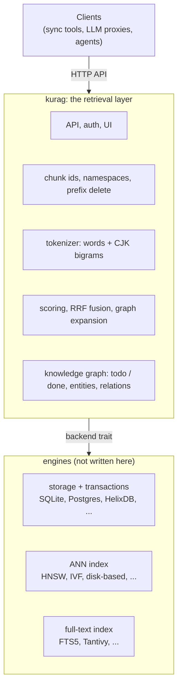

# kurag — design notes (draft)

kurag is a retrieval server for RAG: vector, full-text and hybrid search, a similarity graph, a knowledge graph,
and later agent memory, behind one HTTP API. The name is *kura* (蔵, storehouse) + *RAG*.

## Why

[txtai-kura](https://github.com/otaqq/txtai-kura) showed that most of such a server is not the database engine.
Of its ~1,160 lines of Python, one import uses txtai (the faiss wrapper); the rest is the layer on top:
cutting Japanese into bigrams, scoring and fusing hits, chunk id rules, prefix deletes, knowledge graph
bookkeeping, the API. That layer is what users of the API depend on, and it should outlive any one engine.

kurag keeps that layer and makes the engine replaceable:

Goals, in order:

1. **Same API as txtai-kura** at first, so existing clients switch by changing a URL.
2. **Small resident memory.** txtai-kura measured ~514 MB RSS at 128,396 chunks, of which the vector indexes
   were a small part (45 MB at 60,000 chunks); the rest was the Python libraries.
3. **Grow past RAM.** Vectors quantized (8-bit or lower) and an index that can live on disk, for millions of
   chunks on one machine.
4. **One binary** to ship: container image, release archive, systemd unit, Helm chart.

Not a goal: writing an ANN algorithm, a full-text engine or a storage engine.

## Principles

1. **The API is the product.** Engines change; what clients send and get back does not, except by new versions.
   Contract tests define it.
2. **Own the rules, borrow the engines.** Tokenizing, scoring, fusion, ids and deletes live in kurag, so they
   behave the same on every backend. Storage, ANN and BM25 come from existing engines.
3. **Measure before choosing.** An engine, an index type or a default changes only with numbers from real data
   (recall, RSS, latency), written down in the docs.
4. **Disk first, memory bounded.** Text, graphs and full-precision vectors stay on disk; memory holds quantized
   vectors or a bounded cache, and the docs state how memory grows with data.
5. **Multilingual from the start.** Japanese (no spaces) is searched as well as languages with spaces; tests
   include both.
6. **No hidden work.** No background LLM calls of its own: embedding happens on writes and queries, extraction
   (knowledge graph, memory) is done by clients that report what they learned. Every write is undoable by a
   prefix delete.
7. **Small to run.** One binary, one data folder, configuration in one file or the environment; runs on a
   laptop, a VM or Kubernetes the same way.

## Features

| Feature | v1 | Later |
|---|---|---|
| Namespaces (dotted names, searched with everything under them) | ✓ | |
| Upsert chunks; delete by id prefix (a file, a folder, a source) | ✓ | |
| Vector search (cosine), embedding through an OpenAI-compatible API | ✓ | vectors sent by the client |
| Full-text search: words + CJK bigrams, coverage + BM25 | ✓ | dictionary tokenizer (option) |
| Hybrid search (RRF), cosine for text-only hits | ✓ | |
| Similarity graph between chunks; `graph: n` expansion | ✓ | |
| Knowledge graph: entities, relations, mentions; `/kg/todo` and done marks | ✓ | claims for several extractors |
| Knowledge graph search (`/kg/search`) | ✓ | used inside `/search`; graph-prefiltered search |
| Quantized vectors (8-bit), rebuild from stored vectors | ✓ | 4-bit / binary, disk-based index |
| API key; UI login | ✓ | per-client keys and scopes |
| Graph view in the browser | ✓ | |
| Metrics (`/metrics`, Prometheus format) | ✓ | |
| Embedding endpoints: one URL, a failover list, or an external picker | ✓ | sharing large upserts across machines |
| Agent memory (users, sessions, memories, decay) | | ✓ own design note |
| Backends other than SQLite | | ✓ when measured need appears |

## Language

Rust. Searching is not where it pays off: txtai-kura answers in about a millisecond per namespace once the query
is embedded, and the embedding call dominates. It pays off in resident memory, one static binary, and building
for amd64 and arm64 without a C++ toolchain. For the same reason, engines with C++ build dependencies (faiss) are
not the first choice.

## Forms

| Crate | What |
|---|---|
| `kurag-core` | Library: tokenizer, scoring and fusion, chunk id rules, request and answer types, the backend trait |
| `kurag` | The server and CLI: HTTP API, auth, UI, backends compiled in by feature |

Clients talk HTTP, so they stay in any language. A Python binding of `kurag-core` can come later if someone
needs the tokenizer or scoring in-process.

## API

Version 1 is the txtai-kura API as of v0.3.5: `/health`, `/namespaces`, `/upsert`, `/delete`, `/search`
(`vector`, `text`, `hybrid`, `graph`), `/kg/upsert`, `/kg/todo`, `/kg/delete`, `/kg/search`, `/rebuild`,
`X-API-Key`. Scores keep their meaning (cosine; coverage + BM25 / 10000; RRF), though BM25 values differ
between full-text engines, so text scores match in order, not to the digit.

Changes to the API come after kurag passes the contract tests (below), as new versions.

## Contract tests

Black-box HTTP tests that run against any server with this API: txtai-kura today, kurag as it grows.

- Fixtures: small namespaces in English and Japanese, with known answers (an exact term only text search finds,
  a paraphrase only vector search finds, a hiragana-only query, prefix deletes of a whole file).
- Checks: answers and their shapes, ordering, deletes reaching vectors, full text, edges and the knowledge
  graph, empty namespaces disappearing.
- Not checked: exact score values that depend on the engine.

They come first: they pin down what "the same API" means before any Rust is written.

## Backend trait

One namespace is one unit everywhere (one folder, database, or tenant). A backend provides:

| Part | Operations |
|---|---|
| Chunks | put, get, delete by prefix, count, list ids |
| Vectors | add, remove, nearest k (cosine), stored copy for rebuilds and for scoring text-only hits |
| Full text | add tokens, remove, match with coverage counts, BM25 |
| Edges | similarity edges per chunk |
| Knowledge graph | entities, relations, mentions, per-chunk done marks |

The layer does tokenizing (so every backend indexes the same terms, and CJK works where the engine has no
analyzer for it), scoring, fusion and expansion.

The first backend is **SQLite** (FTS5 for full text, one file per namespace) plus an ANN index. The ANN index is
chosen by measurement (next section).

## Choosing the ANN index

Measured on a copy of real data (stored vectors, no re-embedding), at today's size and at a multiple of it.

| Criterion | Why |
|---|---|
| Recall of the true top 5 vs exact search | IVF with too few probes kept only 55–63 % in txtai-kura |
| RSS and disk per million vectors | goal 2 and 3 |
| 8-bit or lower quantization | goal 3 |
| Incremental add and remove | sync tools send small changes all day |
| Build dependencies | goal 4 |

Candidates (claims to be checked): arroy (Rust, LMDB, disk), hnsw_rs (Rust, in memory), LanceDB (Rust, columnar
on disk, IVF-PQ), sqlite-vec (C, SQLite extension), usearch (C++ core, int8, mmap). Exact search over 8-bit
vectors stays as the baseline: for small namespaces it is fast enough and needs no index.

## Embedding endpoints

Embedding is the only model call kurag makes itself. Where it goes is configurable:

- one URL (the default), or a list tried in order when one fails;
- optionally, an external picker that knows which machines are free, asked per batch with a short cache. For
  example [tasukeai](https://github.com/otaqq/tasukeai) (`/rank` for searches and small upserts, `/spread` to share
  a large upsert across machines). If the picker gives no answer, kurag uses the configured URL, so search does
  not depend on it.

Every endpoint must serve the same model with the same dimensions; kurag checks the dimensions of each endpoint's
first answer and stops using one that differs, since mixed models make cosine scores meaningless.

## Later

- **Knowledge graph in `/search`** (txtai-kura #2), and graph-prefiltered search (traverse, then rank only the
  chunks reached).
- **Agent memory**: users, sessions, memories with provenance, deduplication, correction, decay and expiry. Its
  own design note; the storage parts reuse the backend trait.
- **More backends** only when a measured need appears (size, or a feature such as native graph traversal).

## Open questions

- Data migration from txtai-kura: read its `kura.db` (float16 vectors, chunks, knowledge graph) directly, or
  export / import through the API?
- Japanese tokenizer: keep bigrams only, or add a dictionary tokenizer (Lindera) as an option?
- UI: port the txtai-kura graph view as is, or start read-only and smaller?
- Embedding: keep calling an OpenAI-compatible API (LiteLLM, Ollama), or also accept vectors from the client?
