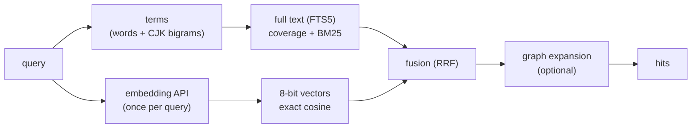

# kurag — how search works

The techniques inside kurag: how text becomes terms, how hits are scored and fused, how vectors are stored, and
what the graphs hold. Why kurag is built this way is in [design.md](design.md); its parts, the current state and
the measured numbers are in [architecture.md](architecture.md).

## Data model

- A **namespace** is a dotted name (`it.infra.k8s`, `academic.math`). Asking for one includes everything under
  it (`academic` covers `academic.math`, not `academics`). Each namespace is one folder with one SQLite database
  (`kurag.db`).
- A **chunk** is a piece of a document, with an id `<source>:<path>#<section>#<n>` (n: its number in the
  section), its text, and the vector of that text. The id carries the document's place, so a client deletes a file,
  a folder or a whole source by id **prefix**.
- What is stored per namespace: chunks, a float16 copy of every vector, a full-text index, a similarity graph and
  a knowledge graph. Memory holds only the 8-bit vectors of the namespaces in use.



## Terms: words and CJK bigrams

Full-text engines cut text at spaces; Japanese and Chinese have none. kurag makes the terms itself
(`kurag-core`, `text.rs`), so every backend indexes the same terms whether or not its engine knows the language.

1. Text is cut into **runs of one script**: Latin letters and digits, katakana, kanji (hiragana is a separate
   script).
2. **Hiragana runs are dropped**, in documents and in queries: they are mostly particles and endings (の, とは,
   する) that would match everything.
3. A katakana or kanji run longer than one character becomes its **overlapping bigrams**: 再起動 → 再起 起動.
   A one-character run stays as it is.
4. Latin words go to the engine as they are; SQLite's `unicode61` tokenizer folds case and accents.

A query is cut the same way, and each run becomes a **phrase**: 再起動 must match 再起 followed by 起動. So a
two-character word such as 認証 is found whatever follows it in the document (認証には, 認証方式), and a query
written as a sentence (認証の仕組み) keeps only its content words (認証, 仕組). Repeated terms count once.

Bigrams need no dictionary and work for any CJK text, at the cost of a larger index than a dictionary tokenizer
(an option for later, see design.md).

## Text score: coverage, then BM25

A text search runs in two steps on each namespace: first chunks with **every** term (AND), then, if that gave
fewer than asked for, chunks with **some** (OR).

The score of a hit is

```
text score = coverage + min(BM25, 99) / 10000
coverage   = sum of the lengths of the query terms the chunk has / sum of the lengths of all query terms
```

- **Coverage** (0 to 1) says how much of the query a chunk has, longer terms weighing more (PostgreSQL counts
  more than 設計). It compares across namespaces.
- **BM25** (from the engine) orders chunks with the same coverage. Alone it would not compare across namespaces:
  a word rare in one namespace scores high there and low in another where it is common.

## Vectors: 8-bit with a range per dimension

The only model call kurag makes is the embedding API (OpenAI-compatible `/embeddings`): on upsert for new or
changed text (chunks sent again with the same text keep their vectors), and once per query for vector and
hybrid search. Vectors are normalized to unit length, so the inner product is the cosine similarity.

Each vector is stored twice:

- **float16 in SQLite**: the truth, half the size of float32, precise enough to serve as the reference.
- **8-bit in memory** (a quarter of float32), for search. For each dimension d, the minimum `min_d` and maximum
  of that dimension over the namespace's vectors are learned, and a component x is stored as one of 256 steps:

```
step_d = (max_d - min_d) / 255
code_d = round((x_d - min_d) / step_d), clamped to 0..255
x_d   ~ min_d + step_d * code_d
```

This is the scalar quantizer known from faiss (SQ8). A single scale for all dimensions is much worse: the
components of a unit vector with hundreds of dimensions are small (typical size 1/sqrt(dimensions), 0.036 for
768), so a fixed scale such as x 127 leaves most steps unused; measured, it lost 2 points of recall@5 and 5 of
top-1 (architecture.md).

Scoring needs no decoding. For a query q:

```
q . x ~ sum_d q_d * min_d  +  sum_d (q_d * step_d) * code_d
```

The first sum and the weights `q_d * step_d` are computed once per query; each vector then costs one multiply-add
per dimension, as with plain 8-bit values.

The ranges are learned from the float16 copies when a namespace is opened, on `/rebuild`, and when the number of
vectors has doubled since they were learned (in between, values outside the range are clamped). A new namespace
learns them from its first upsert, so the first doubling comes soon.

**Search is exact**: the query is compared with every vector of the namespace and the best k are kept, with no
index to build or tune (measured times are in architecture.md). An ANN index (HNSW,
IVF, disk-based) comes when measurements show exact search is too slow for the data (design.md, "Choosing the
ANN index").

## Hybrid search: reciprocal rank fusion

Hybrid search runs both searches and merges the two ranked lists by **reciprocal rank fusion** (RRF): a hit at
rank r (from 0) in a list adds `1 / (60 + r + 1)` to its score.

- Each list is cut to `max(2 x limit, 10)` before fusing.
- Only text hits with **coverage of at least 0.6** join: one common word ("design") would otherwise pull in
  unrelated chunks, while a question written as a sentence has more words than any chunk, so asking for all of
  them (1.0) found nothing. 0.6 measured better than 0.5 and 1.0 on txtai-kura.
- A hit in both lists comes first; on a tie the vector hit wins.
- Every hit carries `vector_score` (for a hit only the text search found, computed from its stored vector) and,
  when the text search found it, `text_score`. A client can keep a similarity threshold on hybrid results.

RRF uses ranks, not scores, so it needs no calibration between cosine and text scores.

## Similarity graph and graph expansion

On upsert each new chunk is linked to its **nearest chunks** in the namespace: up to 10 (`EDGE_NEIGHBOURS`), with
similarity at least 0.4 (`EDGE_MIN`). Edges are stored in both directions, so the neighbours of a chunk are one
indexed lookup. No LLM is involved.

With `graph: n` a search adds up to n chunks linked to its hits by edges of at least `min_weight` (default 0.75).
A neighbour scores **hit score x edge weight** and carries `via`, the id of the hit it hangs on. This brings in
the rest of a section, or the same topic in another document, that the query's wording did not match.

## Knowledge graph

Entities (name, type, description), relations between them (source, target, type, description, weight) and
mentions (entity in chunk) are sent by clients, for example extracted by an LLM. kurag stores them and answers
questions about them; it does not extract.

- **Provenance**: a relation or mention remembers the chunk it was learned from. Deleting chunks by prefix
  removes what was learned from them, and entities left with no relation and no mention go too. A relation sent
  without a chunk stays.
- **Work list**: `/kg/todo` lists chunks not extracted yet. An extraction is marked done with the chunk's row id;
  a chunk sent again gets a new row id, so it is to do again, and its new extraction (`done`) replaces what was
  learned from it before. Several extractors can therefore work through a namespace without keeping their own
  state.
- **Search** (`/kg/search`): entities named exactly like the query first (case ignored), then full-text matches
  on name and description (same terms as above), then the relations around them up to `depth` steps, with the
  chunks that mention each entity.

## Graph view and section labels

The graph view (`/ui`) draws **sections** (the chunks of one heading or page, `<source>:<path>#<section>`)
rather than chunks: two sections are linked by the closest pair of their chunks. A whole namespace can hold tens of
thousands of sections, too many to lay out in a browser, so the view draws one section and those linked to it
(`/ui/around`: up to `depth` steps, 60 more sections, the strongest links first). To start without a search it
lists the **hubs**, the sections linked to the most other sections.

A section's name is a heading or, for books, a page number (`p.103`), which says nothing about what is on it, so
each node is labelled with up to three **keywords**:

1. **Entities** of the knowledge graph mentioned in the section's chunks, when the namespace has been extracted.
   They are ranked by `tf x ln(N / df) x ln(1 + df)`, with tf the section's chunks that mention the entity, df
   all chunks that mention it and N all chunks of the namespace. TF-IDF alone puts the rarest extractions first
   (file names, version numbers); frequency alone puts the topic of the whole namespace on every page (Kubernetes
   in a Kubernetes book); the extra `ln(1 + df)` favours the middle. Only entities mentioned in two chunks or
   more, with a letter in the name and at most 24 characters, count.
2. **Terms** fill the rest: the section's runs (a word, a katakana or kanji compound, as in "Terms"), the 20 most
   frequent looked up in the full-text index and ranked by `(1 + ln tf) x ln(N / df)`. A term in fewer than two
   chunks is left out (mostly text-extraction noise), and so is a term in more than 30 % of the chunks of its own
   file (running heads: the title or author printed on every page). That check counts matches in the run of row
   ids of the file, which the full-text index does fast, since a file's chunks are written together.

Keywords holding one another (再起動 and 再起動方法) count once. The label is made the first time a section is
shown and kept in `section_labels`; upserting or deleting the section's chunks, a knowledge-graph upsert or delete
that touches them, or `/rebuild` forgets it.

Measured on a copy of a real data set (47 namespaces, mostly books, up to 33,000 chunks; 4 vCPU): drawing the
sections around a hub the first time, labels included, took 138 ms at the median and 1.0 s at most; drawn again,
10 ms and 19 ms. Most of the first time is counting each candidate term in the full-text index. Listing the hubs
takes up to 0.85 s on the largest namespaces whether labels are kept or not: that is the query over all edges.
Text extracted from scanned books still yields some OCR noise as terms; sections with knowledge-graph entities
read better.

## Deletes by prefix

A prefix is turned into a range on the unique index of ids: ids starting with `p` are those `>= p` and `< p'`,
where `p'` is `p` with its last character incremented. The prefix is literal (`_` and `%` are not wildcards) and
case matters. One delete reaches the chunk, its vector (in SQLite and in memory), its full-text entry, its edges
and the knowledge graph learned from it; a namespace left with nothing is removed.

## Tools

- `kurag import <dir>`: copies txtai-kura v0.3 namespaces (`<dir>/<namespace>/kura.db`) into `DATA_DIR` without
  embedding calls. Chunks keep their row ids, so edges and done marks carry over; full-text indexes are made again
  with kurag's terms. Read a copy (SQLite backup) of a running server's files.
- `compare <questions.tsv> [modes]` (crate `kurag-contract`): the same questions (`<namespace>\t<query>`) to two
  servers (`A_URL`/`A_KEY`, `B_URL`/`B_KEY`); prints overlap@5, top-1 agreement and latency per mode.
- `kurag recall <questions.tsv>`: exact cosine search over the float16 copies in `DATA_DIR` as the truth; each
  question embedded once; prints recall@5 and top-1 agreement of servers A and B in vector mode. This is how a
  quantization or an ANN index is judged.
- Contract tests (`tests/contract`): black-box tests of the API against any server, with `fake-embed` as a
  stand-in embedding API (design.md, "Contract tests").

All three tools print numbers and ids only, never the text of chunks or questions.
